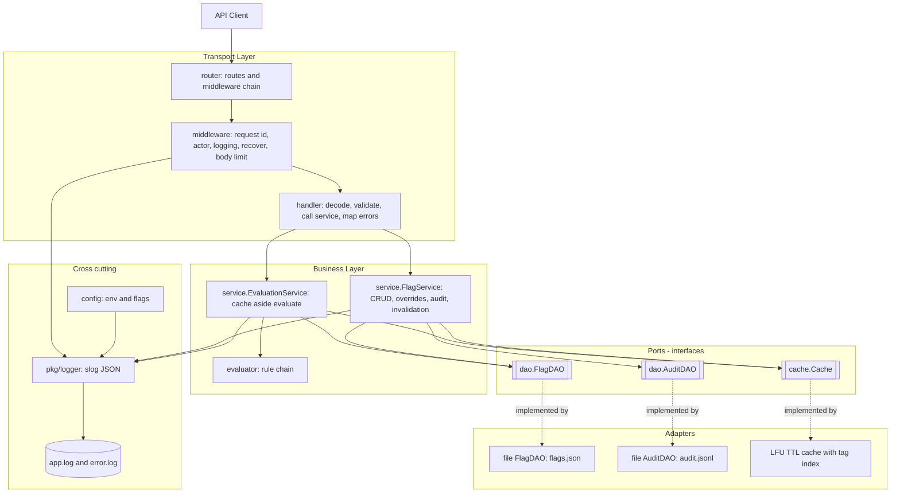
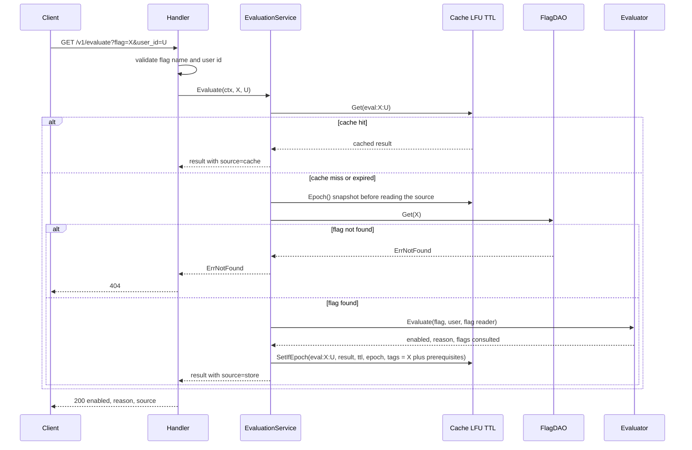
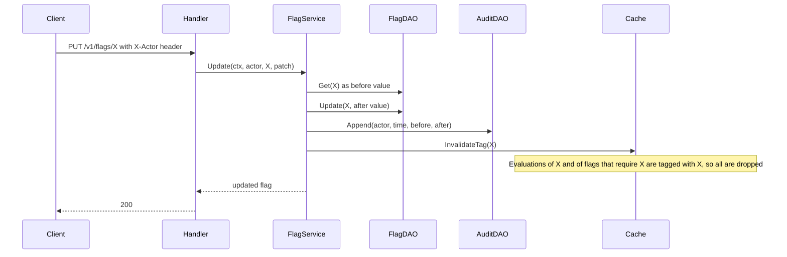
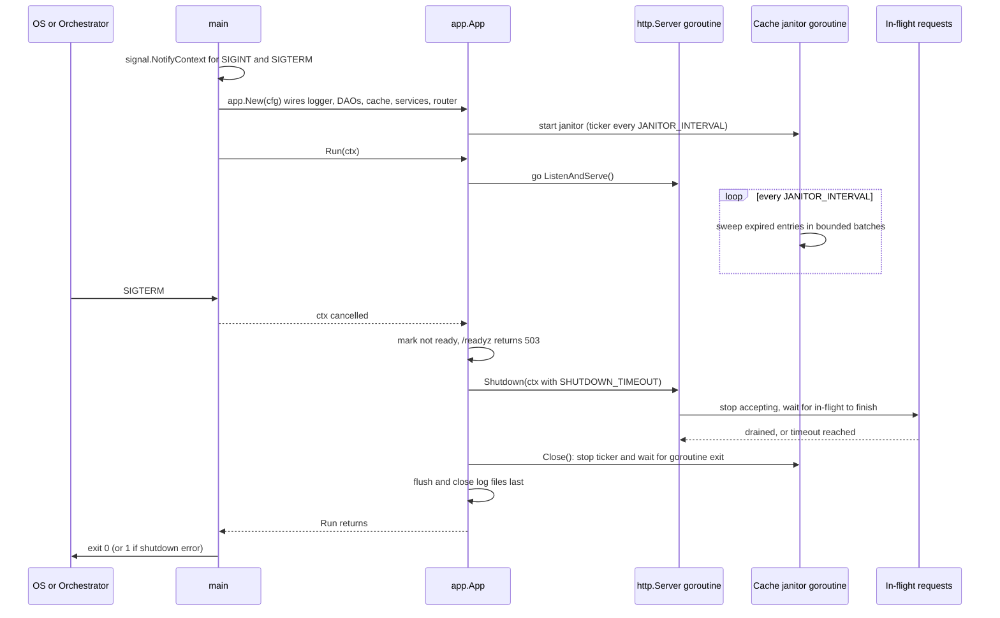

# Feature Flag Service - Engineering Plan (PLAN.md)

## 1. Goals and decisions

Build a production-style REST service in Go that stores feature flags, manages global and per-user state, evaluates flags for a user, caches evaluations, and records an audit trail.

Decisions (revisit only if needed):

- Language and HTTP: Go 1.22+, standard library `net/http` (method and path routing, `r.PathValue`). No web framework.
- Persistence (now): JSON file via a DAO interface. Postgres can replace it later without touching other layers.
- Cache (now): in-memory LFU with per-entry TTL and tag-based invalidation, behind a `Cache` interface.
- Logging: stdlib `log/slog`, JSON output to a log file and stdout, with level separation and request correlation.
- Wiring: constructor-based dependency injection in a single composition root, `internal/app` (`app.New(cfg)`). No globals, no DI framework.
- `cmd/server/main.go` stays minimal (about 25 lines, production style): load config, create a signal-aware context, build the app, run it, and exit non-zero on error. All wiring and lifecycle logic lives in `internal/app`, which keeps it testable.
- Background work: one long-lived goroutine for the cache TTL janitor, and one goroutine for `ListenAndServe`. Both have an explicit stop path and are shut down in a defined order (see 2.4).
- Rule precedence (documented in README): prerequisites -> user override -> global disabled -> percentage rollout -> enabled. Prerequisites are a hard gate even for overrides, so a dependent feature can never be on without its prerequisite. Revisit this if you want overrides to win over everything.

### Why LFU (and why with TTL)

Flag evaluation traffic is highly skewed: a few hot (flag, user) pairs get most of the hits, which is the case LFU is built for. Plain LFU has a known weakness, which is that old entries with high counts never leave. We counter that with a TTL (a safety net and a staleness bound) and explicit invalidation on writes. Complexity is O(1) for get and set using frequency buckets, with no external dependency. LRU and W-TinyLFU (for example `ristretto`) stay as drop-in alternatives because of the `Cache` interface.

## 2. Architecture

### 2.1 Layered view



### 2.2 Evaluation request path (where the cache sits)



Cache bypass cases: a miss, an expired TTL, an invalidated tag, or the request header `Cache-Control: no-cache` (debug aid, logged at debug level). Not-found results are never cached, so a newly created flag is visible immediately.

### 2.3 Write path and cache invalidation



Invalidation strategy (to be explained in the README):

1. Write-through to the store first, then invalidate. A read between the two sees either the old cached value or a fresh recompute, never a corrupted one.
2. Every cached evaluation is tagged with its own flag name and every prerequisite flag it consulted. `InvalidateTag(name)` removes all entries for that flag and for any flag depending on it, with no separate reverse-dependency graph needed.
3. Per-user override changes invalidate the whole flag tag (simple and correct). A finer key delete `eval:X:U` is a possible optimisation.
4. TTL (default 60s) bounds staleness if anything is missed. This also covers the multi-instance case until Redis or pub/sub is added.
5. Delete invalidates the tag too, and deleting a flag that other flags require returns 409.
6. Stale-fill protection. Without it, a reader that loaded the old flag could store its result after a writer's invalidation and keep serving it until the TTL. Readers therefore snapshot `Epoch()` before reading the source and store with `SetIfEpoch`, which is refused if any invalidation happened in between. The epoch advances even when the invalidated tag has no entries, because the writer's change may predate any cached entry.

### 2.4 Process lifecycle: startup, janitor, and graceful shutdown



Shutdown order matters: stop taking traffic first, then drain requests, then stop background workers, and close the logger last so the final lines are written.

## 3. Project structure

```
feature-flag-service/
  cmd/
    server/
      main.go                  # minimal entrypoint only: config, signal context, app.New, app.Run, exit code
  internal/
    app/
      app.go                   # composition root: New(cfg) wires logger -> DAOs -> cache -> services -> handlers -> router -> http.Server
      run.go                   # Run(ctx): ListenAndServe goroutine, wait for signal or failure, ordered graceful shutdown, closers
    config/
      config.go                # env-based config (PORT, DATA_DIR, LOG_DIR, LOG_LEVEL, CACHE_CAPACITY, CACHE_TTL, CACHE_JANITOR_INTERVAL, SHUTDOWN_TIMEOUT, HTTP timeouts)
    domain/
      flag.go                  # Flag, Override, validation rules
      audit.go                 # AuditEntry, Action constants
      errors.go                # ErrNotFound, ErrAlreadyExists, ErrInvalid, ErrConflict
    dao/
      flag_dao.go              # FlagDAO interface
      audit_dao.go             # AuditDAO interface
      file/
        flag_dao.go            # JSON file implementation, RWMutex, atomic temp-file + rename
        audit_dao.go           # append-only JSON lines implementation
      memory/
        flag_dao.go            # in-memory implementation for tests
        audit_dao.go
    evaluator/
      evaluator.go             # Evaluator + Rule interface, result type
      rules.go                 # PrerequisiteRule, OverrideRule, GlobalRule, RolloutRule
    service/
      ports.go                 # consumer-defined interfaces: Clock, IDGenerator, Invalidator, EvalCache, FlagEvaluator
      flag_service.go          # CRUD, overrides, audit, invalidation
      evaluation_service.go    # cache-aside evaluation
      audit_service.go         # read-only audit history
      keyedlock.go             # per-flag lock that honours context cancellation
    handler/
      flag_handler.go          # FlagCRUD interface + create, list, get, update, delete
      override_handler.go      # OverrideManager interface + set, remove
      evaluate_handler.go      # FlagEvaluator interface
      audit_handler.go         # AuditHistory interface
      health_handler.go        # Readiness interface, /healthz and /readyz
      errors.go                # the one place domain errors become HTTP statuses
      dto.go                   # request and response structs (the wire format)
    middleware/
      middleware.go            # Middleware type, Chain, response status recorder
      requestid.go
      actor.go
      logging.go
      recover.go
      bodylimit.go
    router/
      router.go                # builds http.Handler from handlers + middleware chain
  pkg/
    cache/
      cache.go                 # Cache interface (Get, Set with ttl and tags, Delete, InvalidateTag, Stats)
      lfu/
        lfu.go                 # O(1) LFU with frequency buckets, TTL, tag index
        janitor.go             # background TTL sweeper goroutine, Close() stops it
    logger/
      logger.go                # slog setup: JSON, file and stdout, level split, rotation
      context.go               # logger and request id in context
    httpx/
      response.go              # WriteJSON, WriteError, the single error body shape
      decode.go                # strict DecodeJSON and RequestError (domain-agnostic)
  api/
    openapi.yaml               # optional, if time allows
  data/                        # runtime data (gitignored): flags.json, audit.jsonl
  logs/                        # runtime logs (gitignored): app.log, error.log
  .github/workflows/ci.yml
  Dockerfile
  Makefile
  .gitignore
  go.mod
  PLAN.md
  README.md
```

Layering rules (enforced by review):

- `domain` imports nothing from the project.
- `service` depends only on `dao` and `cache` interfaces, never on concrete types or `net/http`.
- `handler` depends only on narrow interfaces it declares itself, the service-layer types they mention, and `httpx`. `httpx` knows nothing about the domain, so the domain-error to status mapping lives in `handler/errors.go`.
- Concrete implementations are chosen only in `internal/app` (called from `cmd/server/main.go`).
- `main.go` contains no business logic, no wiring details, and no goroutines of its own.
- Interfaces are declared next to their consumer's contract (`dao`, `cache`) so fakes are trivial in tests.

## 4. Key contracts

```go
// internal/dao - each contract is split into a read half and a write half
type FlagReader interface {
    Get(ctx context.Context, name string) (domain.Flag, error)
    List(ctx context.Context) ([]domain.Flag, error)
}
type FlagWriter interface {
    Create(ctx context.Context, f domain.Flag) error
    Update(ctx context.Context, f domain.Flag) error // optimistic: f.Version must be stored version + 1, else ErrConflict
    Delete(ctx context.Context, name string) error
}
type FlagDAO interface { FlagReader; FlagWriter }

type AuditWriter interface {
    Append(ctx context.Context, e domain.AuditEntry) error
}
type AuditReader interface {
    ListByFlag(ctx context.Context, flagName string, limit int) ([]domain.AuditEntry, error)
}
type AuditDAO interface { AuditWriter; AuditReader }

// pkg/cache
type Cache interface {
    Get(key string) (any, bool)
    Set(key string, value any, ttl time.Duration, tags ...string)
    Epoch() uint64 // advances on every Delete and InvalidateTag, even when nothing was removed
    SetIfEpoch(key string, value any, ttl time.Duration, epoch uint64, tags ...string) bool // stale-fill guard
    Delete(key string)
    InvalidateTag(tag string)
}

// pkg/cache/lfu - the concrete cache also implements io.Closer (stops the janitor)
type Config struct {
    Capacity        int
    DefaultTTL      time.Duration
    JanitorInterval time.Duration // 0 disables the janitor (useful in tests)
    SweepBatchSize  int           // entries scanned per lock hold, so the sweep never blocks readers for long
    Clock           func() time.Time // injectable for tests
}
func New(cfg Config, log *slog.Logger) (*Cache, error) // error when Capacity < 1 or JanitorInterval < 0
func (c *Cache) SweepNow() int // removes expired entries, returns count (used by janitor and tests)
func (c *Cache) Close() error  // idempotent (sync.Once): stops the ticker, waits for the goroutine

// internal/evaluator - declares the one capability it needs (dependency inversion);
// dao.FlagReader satisfies it without the evaluator importing the dao package
type FlagLookup interface {
    Get(ctx context.Context, name string) (domain.Flag, error)
}

type Rule interface {
    Name() string
    Apply(ctx context.Context, in Input) (d Decision, decided bool, err error) // decided=false passes to the next rule
}

// Result carries Enabled, Reason, DecidedBy (rule name) and Consulted (every flag read,
// used as the cache tags). Evaluate(ctx, flagName, userID) and EvaluateFlag(ctx, flag, userID).
```

Domain model:

```go
type Flag struct {
    Name           string          // ^[a-zA-Z0-9][a-zA-Z0-9_.-]{0,63}$ (no spaces, max 64)
    Description    string          // max 256
    Enabled        bool            // global state
    Overrides      map[string]bool // userID -> enabled
    RolloutPercent int             // 0..100, default 100 (extension)
    Requires       []string        // prerequisite flag names (extension)
    Version        int64
    CreatedAt      time.Time
    UpdatedAt      time.Time
}

type AuditEntry struct {
    ID        string
    FlagName  string
    Actor     string          // from X-Actor header
    Action    string          // flag.created, flag.updated, flag.deleted, override.set, override.removed
    Before    json.RawMessage // null on create
    After     json.RawMessage // null on delete
    RequestID string
    At        time.Time
}
```

## 5. REST API

- POST `/v1/flags` - create (201, 400 invalid, 409 duplicate)
- GET `/v1/flags` - list (200)
- GET `/v1/flags/{name}` - read (200, 404)
- PUT `/v1/flags/{name}` - update description, enabled, and later rollout and requires (200, 400, 404)
- DELETE `/v1/flags/{name}` - delete (204, 404; 409 if required by others once FFS-13 lands)
- PUT `/v1/flags/{name}/overrides/{userId}` - set override, body `{"enabled": true}` (200, 400, 404)
- DELETE `/v1/flags/{name}/overrides/{userId}` - remove override (204, 404)
- GET `/v1/evaluate?flag=X&user_id=U` - response `{"flag":"X","user_id":"U","enabled":true,"reason":"user_override","source":"cache|store"}` (200, 400, 404)
- GET `/v1/flags/{name}/audit?limit=50` - audit trail, newest first (200, 400). An unknown or deleted flag returns 200 with its (possibly empty) history, not 404, so the history of a deleted flag stays readable.
- GET `/healthz` and `/readyz` - health checks

Conventions:

- Writes (POST, PUT, DELETE) require the `X-Actor` header (400 `missing_actor`). Reads without it are recorded as `anonymous`. A present but invalid actor is rejected on any method (400 `invalid_actor`).
- A client-supplied `X-Request-ID` is reused if it is at most 64 characters of letters, digits, `-`, `_` or `.`; anything else is replaced, so a client cannot inject newlines into the log. The id is echoed in the response header and in every error body.
- Errors use a single JSON shape `{"error":{"code":"not_found","message":"...","request_id":"..."}}`, including the router's own 404 and 405 (with an `Allow` header).
- Status mapping (`handler/errors.go`): invalid input 400 `invalid_request`, not found 404 `not_found`, duplicate 409 `already_exists`, version conflict 409 `conflict`, audit write failed after the change 500 `audit_failed`, request timed out 504 `timeout`, client went away 499 `client_closed_request`, anything else 500 `internal` with a fixed message (the real cause is logged with the request id, never sent).
- Request bodies: JSON only (415 for another Content-Type), unknown fields rejected, an empty, malformed or multi-value body rejected (400), and a body over 1 MiB rejected (413).
- Creating a flag without `enabled` starts it disabled. Updates and overrides are partial: an omitted field is unchanged, and an override requires `enabled`.

## 6. Logging design (`pkg/logger`)

- Built on `log/slog` with a JSON handler. Output goes to `logs/app.log` and stdout, and records at warn and above also go to `logs/error.log`.
- Levels: DEBUG (cache hit or miss detail, rule decisions, DAO calls), INFO (request completed, flag changed, startup and shutdown), WARN (validation failures, 4xx, cache bypass, slow requests), ERROR (5xx, DAO failures, panics with stack).
- Level is controlled by `LOG_LEVEL`, with `info` as the production default.
- Every request log line carries: `time`, `level`, `request_id`, `actor` (user name from `X-Actor`, or `anonymous`), `method`, `path`, `status`, `duration_ms`, `remote_addr`, and `user_id` for evaluate calls.
- Request-scoped logger: the middleware builds a child logger with `request_id` and `actor` and stores it in the context. Services and DAOs call `logger.FromContext(ctx)`, so the whole trace of a user request is correlated by `request_id`.
- Rotation via `lumberjack` (size and age limits) or `logrotate` documented in the README.
- Never log secrets or full request bodies.

## 7. Evaluation rules

Rule chain, evaluated in order (each rule can return a decision or pass to the next):

1. Flag missing -> `ErrNotFound` (404).
2. PrerequisiteRule (extension) - if any required flag is not enabled for this user -> false, reason `prerequisite_failed`. Uses a cycle-safe depth limit.
3. `OverrideRule` - if the user has an override, return it, reason `user_override`.
4. `GlobalOffRule` - if the flag is globally disabled -> false, reason `global_off`.
5. RolloutRule (extension) - `fnv32a(flagName + ":" + userID) % 100 < RolloutPercent` -> true, otherwise false, reason `rollout_in` or `rollout_out`.
6. `GlobalOnRule` (terminal) -> true, reason `global_on`.

The chain is built by `evaluator.DefaultRules()`. Extensions are added there, as new rules in the order above, without editing the Evaluator or the existing rules. The evaluator is pure (inputs in, decision out), so the unit tests need no I/O. A chain that ends without a decision fails with `ErrNoDecision`, which is a misconfiguration (500), not a client error.

## 7a. Design principles applied (SOLID)

- Single responsibility: each rule decides one concern, and the Evaluator only runs the chain. Caching, auditing and logging stay in the service layer.
- Open/closed: percentage rollout and prerequisites are new rules in `DefaultRules()`. The Evaluator, the existing rules and the services do not change. Tests prove a new rule can be inserted without touching the Evaluator.
- Liskov substitution: every `Rule` honours one documented contract (stateless, never mutates the flag, deterministic, undecided returns a zero Decision), enforced by a test over all rules. Every DAO implementation passes the same contract suite in `daotest`.
- Interface segregation: DAOs are split into reader and writer halves, and consumers depend on the narrowest interface they use (the evaluator needs one `Get` method). Services declare their own small interfaces for the cache and the clock, rather than importing the largest one.
- Dependency inversion: high-level code (`service`, `evaluator`) depends on interfaces declared by the consumer. Concrete types (file DAO, LFU cache, logger) are chosen only in `internal/app`.

## 8. Tickets

Priority: P0 = required, P1 = required deliverable, P2 = extension. Work them in order; each ticket should end with `go build ./...` and `go test ./...` passing and a commit.

### FFS-1 Project scaffolding (P0) - first
- Initialise `go.mod`, create the folder tree from section 3 with `.gitkeep` or stub files, `.gitignore` (`data/`, `logs/`, binaries), `Makefile` (`run`, `test`, `lint`, `build`), and write this plan to `PLAN.md`.
- `cmd/server/main.go` is created in its final minimal shape (see "Target main.go" below). At this stage `internal/app` only builds a bare router with `/healthz`.
- Done when: `make run` serves `/healthz`, and the layout matches this document.

Target `main.go` (the whole file, about 25 lines):

```go
package main

import (
    "context"
    "fmt"
    "os"
    "os/signal"
    "syscall"

    "feature-flag-service/internal/app"
    "feature-flag-service/internal/config"
)

func main() {
    if err := run(); err != nil {
        fmt.Fprintln(os.Stderr, "fatal:", err)
        os.Exit(1)
    }
}

func run() error {
    ctx, stop := signal.NotifyContext(context.Background(), os.Interrupt, syscall.SIGTERM)
    defer stop() // after the first signal, a second Ctrl-C force-quits

    cfg, err := config.Load()
    if err != nil {
        return err
    }
    a, err := app.New(cfg)
    if err != nil {
        return err
    }
    return a.Run(ctx)
}
```

Why this shape: `main` only maps errors to an exit code. `run()` returns errors so deferred cleanup always executes (calling `os.Exit` or `log.Fatal` inside the logic would skip defers). Everything else is testable inside `internal/app`.

### FFS-2 Config and logging (P0)
- `internal/config` loads env vars with defaults and validation.
- `pkg/logger` implements the file and stdout JSON handlers, the level split, `error.log`, rotation, and context helpers.
- Done when: log lines in `logs/app.log` contain time, level, and the request fields, and a unit test checks level filtering.

### FFS-3 Domain and validation (P0)
- `domain.Flag`, `AuditEntry`, sentinel errors, and `Flag.Validate()` (name regex, max lengths, rollout range).
- Unit tests for valid and invalid names (empty, spaces, too long, illegal characters).

### FFS-4 DAO layer (P0)
- `FlagDAO` and `AuditDAO` interfaces, a file implementation (load on start, `sync.RWMutex`, atomic temp-file + rename on write, append-only `audit.jsonl`), and an in-memory implementation for tests.
- Shared DAO contract tests run against both implementations.
- Done when: data survives a restart, and concurrent access passes with `go test -race`.

### FFS-5 LFU cache (P0)
- `pkg/cache` interface and `pkg/cache/lfu`: O(1) get and set via frequency buckets and a doubly linked list, capacity eviction, per-entry TTL with lazy expiry on `Get`, tag index with `InvalidateTag`, and thread safety.
- TTL janitor (`janitor.go`): a background goroutine started by `lfu.New` when `JanitorInterval > 0`.
  - Why: lazy expiry alone leaves entries that are never read again in memory until LFU evicts them, and a stale low-frequency entry may sit a long time.
  - How: `time.Ticker` loop with `select` on `ticker.C` and a `stop` channel. Each tick calls `SweepNow()`, which pops expired entries from an expiry min-heap (O(log n) each, no full scan) in batches of `SweepBatchSize`, releasing the lock between batches so `Get` and `Set` are never blocked for long. Removing an entry also removes it from the frequency bucket and the tag index.
  - Lifecycle: the goroutine is tracked with a `sync.WaitGroup`. `Close()` is idempotent (`sync.Once`), closes `stop`, and waits for the goroutine to exit. The goroutine recovers from panics, logs them at error level, and keeps running.
  - Logging: debug level line per sweep with `expired_count`, `remaining`, and `duration_ms`. Nothing is logged when zero entries expire.
  - Config: `CACHE_JANITOR_INTERVAL` (default 30s, 0 disables).
- Concurrency design (documented at the top of `lfu.go`): one mutex guards all state; every critical section uses `defer Unlock`; the clock is read and nothing is logged while the lock is held; `*Locked` helpers never lock; `Close` never holds the lock while waiting for the janitor. The epoch protocol (`Epoch` and `SetIfEpoch`) closes the cache-aside stale-fill race.
- Unit tests: eviction order by frequency (and by recency on ties), TTL expiry (injectable clock), tag invalidation, a `-race` concurrency test, `SweepNow()` removes only expired entries and cleans the tag index, the janitor removes expired entries without any `Get`, and `Close()` stops the goroutine (verified with a goroutine count check or `goleak`) and can be called twice safely.

### FFS-6 Evaluator (P0)
- `Evaluator`, the `Rule` interface, and `OverrideRule`, `GlobalOffRule`, `GlobalOnRule`, with the rule chain built by `DefaultRules()`. The evaluator declares its own `FlagLookup` interface and records every flag a rule reads (`Result.Consulted`) through a per-evaluation decorator, so rules stay unaware of cache tagging.
- Also in this ticket (interface segregation): `dao.FlagDAO` and `dao.AuditDAO` are split into reader and writer halves, with compile-time checks that every implementation satisfies them.
- Required unit tests: global on, global off, override on over global off, override off over global on, user without an override uses global, and flag not found. Plus: invalid input, cancelled context, storage errors not mistaken for not-found, a new rule inserted without changing the evaluator, first deciding rule wins, no-terminal-rule error, rule errors keep their sentinel, consulted-flag tracking, the rule contract for every default rule, and a concurrent evaluation test under `-race`.

### FFS-7 Services (P0)
- `FlagService`: create, get, list, update (partial), delete, set or remove override. Every write follows one order: take the per-flag lock, read, build the next version, store through the DAO (optimistic version check), invalidate `FlagTag(name)`, then append the audit entry (actor, time, before, after, request id).
  - Invalidation comes before the audit append to keep the stale window short. Both run on `context.WithoutCancel(ctx)`, so a client disconnecting after the commit cannot leave a stale cache or a missing audit entry.
  - A per-flag lock (channel based, so a waiting request still honours its context deadline) serialises writers of one flag and keeps audit order identical to version order. Writes to different flags run in parallel. The optimistic retry on `domain.ErrConflict` (at most 3 attempts, then 409) remains for changes made outside this process.
  - Updates that change nothing are no-ops: no write, no version bump, no audit entry, no invalidation.
  - If the audit append fails after the change was committed, the change is not rolled back. The full entry is logged at error level and the caller gets `ErrAuditFailed` (a 500), so the failure is never silent.
- `EvaluationService`: cache-aside using key `eval:{flag}:{user}` (flag names cannot contain `:`, so keys are unambiguous), tagged with `FlagTag` for every flag the evaluation consulted. Input is validated before the cache is touched. On a miss it follows the epoch protocol: read `cache.Epoch()`, evaluate, store with `cache.SetIfEpoch(...)`; the result is returned even when the store is refused. Errors, including not-found, are never cached, so probing random names cannot fill the cache.
- `AuditService`: newest-first history, depends only on `dao.AuditReader`. A zero limit uses the default (50), a negative limit is invalid, a limit above 1000 is capped, and an unknown flag returns an empty list rather than 404. A deleted flag keeps its history, ending with the `flag.deleted` entry.
- Interfaces and dependency injection (SOLID), all declared in `service/ports.go` by the consumer: `Clock`, `IDGenerator`, `Invalidator` (only `InvalidateTag`), `EvalCache` (only `Get`, `Epoch`, `SetIfEpoch`) and `FlagEvaluator` (only `Evaluate`). `FlagService` takes `dao.FlagDAO`, `dao.AuditWriter` and an `Invalidator`. `EvaluationService` takes a `FlagEvaluator` and an `EvalCache`, so it never sees a DAO. The real clock and ID generator are the defaults; tests inject fakes.
- Lock order is service lock, then DAO and cache locks. Neither the DAOs nor the cache call back into the service, so no cycle exists. The actor and request id come from the request context (set by the FFS-8 middleware); a missing actor is recorded as `anonymous`.
- Tests: audit contents (before, after, actor, request id, time) for every action; invalidation and audit ordering; conflict retry using fresh data; bounded retry exhaustion; storage and audit failures; cancellation after commit; lock waits that honour deadlines; 40 concurrent writers to one flag losing no updates with audit order equal to version order; a concurrent mixed-operation run whose audit trail replays to the stored state; deterministic stale-fill refusal; and a read-your-writes test under `-race` with readers racing a writer that toggles a flag.

### FFS-8 HTTP layer (P0)
- `pkg/httpx`: `WriteJSON` (encodes before sending, so a failure is a clean 500), `WriteError`, and a strict `DecodeJSON`.
- Middleware, outermost first: request id, actor, logging, recover, body limit. This differs from the first sketch, which put recover first. With logging outside recover, a request whose handler panicked still gets an access-log line with status 500 and its request id, and recover can still use the request id for the error body.
- Handlers, each with its own consumer-defined interface (`FlagCRUD`, `OverrideManager`, `FlagEvaluator`, `AuditHistory`, `Readiness`), so each sees only what it uses. The router takes them through `router.Deps`, validates that none is missing, and wraps Go's `ServeMux` so unknown paths and wrong methods also answer in the JSON error shape.
- The composition root already wires the real file DAOs, LFU cache, evaluator, services and handlers, so the binary serves the full API. `/readyz` reads the app's readiness flag.
- Tests: handlers run behind the real router and middleware with fake services, so every error the services can produce is injected and checked for its status, code and for leaks. A real-stack test runs the actual services, DAOs and cache behind an HTTP server: the full lifecycle, every documented status code, one winner among 30 concurrent creates, and read-your-writes while clients hammer the same flag.
- Done when: every endpoint in section 5 returns the documented status codes, and a missing flag returns 404 (verified for every route that takes a flag name).

### FFS-8A Application bootstrap and graceful shutdown (P0)
Implements `internal/app` and the lifecycle in section 2.4. Worked right after FFS-8, which had already landed `app.New` (the composition root), the readiness flag and `/readyz`. This ticket finished `Run`, added the drain delay, and tested the whole lifecycle, including the real binary receiving real signals.

**Design**
- `app.New(cfg, opts...)` builds the graph and registers every resource with a `Close` in creation order. The logger is registered first so it is closed last and the final lines reach the files (pinned by a test, because nothing else would notice). `WithLogOutput(w)` redirects the console copy of the logs; tests use it to stay quiet.
- `app.Run(ctx)`:
  1. A second call returns an error (run-once guard).
  2. The listener is bound synchronously, so "address already in use" is returned straight away instead of being discovered later on another goroutine. `Started()` is closed once it is bound and `Addr()` reports the real address, which is how tests use port 0.
  3. `Serve` runs in its own goroutine. Any error other than `http.ErrServerClosed` goes to a buffered channel; `Run` selects on that and `ctx.Done()`. A server failure flips readiness, releases resources and returns `server failed: ...`.
  4. On signal: log it, flip readiness to false (`/readyz` answers 503), and if `SHUTDOWN_DELAY` is set keep serving for that long so a load balancer sees the failing probe before the listener closes. A server failure during the delay is logged and cuts the wait short.
  5. `Shutdown` with `SHUTDOWN_TIMEOUT`. If it does not finish, log a warning, force `Close()` and return the error wrapped as `graceful shutdown: ...`.
  6. Wait for the serve goroutine, then close resources in reverse creation order (cache and its janitor first, logger last). A close error is returned only if nothing earlier failed, but every closer still runs.
- Exit codes live in `main`: `Run` returns nil after a clean shutdown (exit 0); startup or runtime failures print `fatal: ...` to stderr and exit 1. Both SIGINT and SIGTERM are handled; a second signal during shutdown does nothing.
- Config added: `SHUTDOWN_DELAY` (default 0, must not be negative), alongside `SHUTDOWN_TIMEOUT` and the `HTTP_*` timeouts.
- The listen function is an unexported field defaulting to `net.Listen`, so tests can inject a listener that fails on demand. There are no test-only fields in production code.

**Tests**
- `internal/app` (93% coverage): serve then stop cleanly on cancel; an in-flight slow request completes during shutdown while a new connection is refused; `/readyz` is 503 while draining (and `/healthz` still 200); the drain delay is honoured; a drain timeout forces `Close` and is reported; the janitor goroutine is gone after `Run` returns; the port already taken, `Run` twice, and `New` failures all clean up after themselves; closers run in reverse order and all run even after one fails; a server failure, and a server failure during the drain, are reported and release resources; a close error is surfaced; `Run` does not return before the serve goroutine; the logger is registered first; and 20 concurrent clients during shutdown each get an answer or a refusal, never a hang.
- `cmd/server` (re-executes the test binary as the server, so it runs the real `main` with real signals): SIGTERM and SIGINT give exit 0 and the expected log lines; `SHUTDOWN_DELAY` keeps `/healthz` at 200 while `/readyz` is 503 and delays the exit; an occupied port, unparsable config, out-of-range port and negative delay each exit 1 with `fatal:`; a second SIGTERM does not restart or break the shutdown.
- Stress: `-race -count=15 -cpu 1,2,8` on `internal/app` and `-count=4 -cpu 1,4` on `cmd/server`, clean.
- Mutation testing of `Run`, `closeAll` and the registration order: 16 planted bugs, 15 killed by a relevant test. The survivor (not waiting for the serve goroutine) is equivalent because `http.Server.Shutdown` already waits for `Serve` to return in Go 1.22; the wait stays as a guarantee that does not depend on that detail.

**Notes**
- A `-race` binary sleeps one second at exit by default; the subprocess tests set `GORACE=atexit_sleep_ms=0`. The real binary stops in well under a millisecond when idle.
- Done when: `kill -TERM <pid>` on the running binary logs the shutdown sequence, finishes in-flight work, and exits with code 0, and `go test -race` is clean. Both verified.

### FFS-9 Tests (P1)
Handler tests for error mapping and validation edge cases already landed with FFS-8 (about 40 tests at 100% coverage, with fake services behind the real router and middleware), and the router tests run the real services on in-memory storage. What was missing was the real thing end to end, so this ticket adds `internal/integration`: black-box tests that start the production composition root (`app.New` and `app.Run`) with real file DAOs, the real LFU cache and the real logger, and talk to it over real TCP. Nothing is faked. Only the public `app` API is used, and the wire types are redeclared in the tests so they check the documented JSON rather than the server's own structs.

| Test | What it proves |
| --- | --- |
| `TestFlagLifecycleOnRealFiles` | The full sequence: validation failures leave no trace; create, evaluate off (`global_off`, `store`), override (`user_override`), evaluate again (`cache`), update (invalidated), remove override, audit trail in order with actors, delete, evaluate 404. Then `flags.json` no longer holds the flag and `audit.jsonl` has one valid line per write. |
| `TestEveryRequestIsTraceableThroughLogsAndAudit` | One request id travels from the client header to the response header, the access-log line (time, level, actor, method, path, status) and the audit record. Generated ids when absent; unsafe client ids are not reused; a clean run leaves `error.log` empty. |
| `TestClientErrorsAreWarningsNotErrors` | 4xx responses log at `warn`, so `error`-level records mean real server faults. |
| `TestStateSurvivesARestart` | Flags, overrides, deletes and the audit history survive a restart; the cache starts cold but answers correctly; versions and history continue; the log file is appended, not replaced. |
| `TestStartsAfterACrashLeftDebrisOnDisk` | A half-written audit line and an unfinished `flags.json.tmp-*` file do not stop startup or leak data, and the next write is recorded cleanly across two more restarts. |
| `TestInvalidationIsScopedToTheFlagThatChanged` | Updating flag A leaves flag B's cached answers in place. |
| `TestACachedAnswerExpiresAfterItsTTL` | Real clock and real janitor: a cached answer goes back to the store after its TTL. |
| `TestCapacityPressureNeverChangesAnAnswer` | A 5-entry cache under 40 users never returns a wrong answer. |
| `TestConcurrentWritersAndReadersLeaveAConsistentRecord` | 6 writers and 6 readers on one flag: no 5xx, a gap-free audit chain (every entry starts from the previous entry's end state), final version equals the number of entries, store equals the last audit state, and once writes stop every answer, cached or not, matches the truth. |
| `TestAnAcknowledgedWriteIsNeverFollowedByAStaleAnswer` | Background readers keep the cache hot while a writer toggles the flag 80 times; each acknowledged write is visible to the very next evaluation. |
| `TestConcurrentCreatesOfOneNameHaveOneWinner` | 25 concurrent creates give one 201, 24 clean 409s and one audit entry. |
| `TestWritesThatChangeNothingAreNoOps` | A repeated update or override is acknowledged but changes no version, adds no audit entry and keeps cached answers; removing an override that was never set is a 404. |

- Verification: `-race -count=10 -cpu 1,2,8` is clean. Thirteen planted bugs were run against the suite: 11 killed by a relevant test (missing invalidation on update, override and delete; shared cache tag; entries never expiring; torn audit tail not repaired; request id missing from audit; 4xx logged as errors; no per-flag lock; no-op writes audited; `flags.json` never written; override ranked below global state). Two survivors, both understood: skipping invalidation on create is equivalent today because errors are never cached, but it will matter once flag dependencies exist (FFS-13); and reading the cache epoch after evaluating (defeating the stale-fill guard) is a microsecond window that no HTTP-level test can hit reliably, so it is caught deterministically by `TestStaleFillIsRefused` in the service unit tests.
- Also in this ticket: a curl-based script, `sample_test/integration_test.sh` (`make integration`), checks the same behaviour against any running server.
- Done when: the sequence above passes against real files and `go test -race ./...` is clean. Both verified.

### FFS-10 CI (P1)
`.github/workflows/ci.yml` runs on every push, every pull request and on demand. A newer push to the same ref cancels the older run, and the token is read-only (`permissions: contents: read`). Four jobs, independent where possible so one kind of failure never hides another:

| Job | What it does | Fails when |
| --- | --- | --- |
| `lint` | `gofmt -s -l` (lists the offending files), `go vet ./...`, `go mod tidy` followed by `git diff --exit-code go.mod go.sum`, `go mod verify` | formatting drift, a vet finding, a stale or untidy module file, a tampered module |
| `test` | `go test -race -shuffle=on -count=1 -covermode=atomic -coverprofile` on Go 1.22 (the minimum in `go.mod`) and `stable`; total coverage goes to the job summary and the profile is uploaded as an artifact | any test or data race fails, or a test only passes in one order, or the newest Go breaks something |
| `build` | static builds (`CGO_ENABLED=0 -trimpath -ldflags="-s -w"`, the same flags as `make build`) for linux/amd64, linux/arm64 and darwin/arm64 | the code stops compiling on a target platform |
| `e2e` | runs `sample_test/integration_test.sh` after `test` passes: real binary, HTTP, SIGTERM, restart, persistence | any of its 77 checks fails |

- `-race` needs cgo, which the Ubuntu runner has; `-count=1` bypasses Go's test cache so CI always runs the tests; `-shuffle=on` surfaces order dependence.
- `make ci` runs the same steps locally (lint, tidy check, verify, race tests with coverage, build, end-to-end script), so a green `make ci` predicts a green pipeline.
- Verification, since a pipeline cannot be run from here: `actionlint` reports no problems; every `run:` step was extracted from the YAML and executed locally; each gate was shown to trip (an unformatted file, a `go vet` error, a stale `go.sum`, a failing unit test and a failing e2e check all exit 1 with a readable message); the suite passes on Go 1.22.2 and 1.24.5, shuffled, pinned to a single core with `-cpu 1`, and with a CPU hog competing for that core, which approximates a small shared runner; all three build targets compile.
- Actions are pinned to major versions (`checkout@v4`, `setup-go@v5`, `upload-artifact@v4`). Pinning to commit SHAs is the stricter option if supply-chain policy requires it.
- To make CI binding, enable branch protection on the default branch and require `Format, vet and modules`, `Test (Go 1.22)`, `Test (Go stable)` and the `Build` and `End-to-end script` checks.
- Done when: the workflow is lint-clean and every step passes locally. Both verified; the first real run happens when the repository is pushed to GitHub (deferred).

### FFS-11 Documentation (P1)
- README: overview, setup and run, configuration table, API reference with curl examples, evaluation rules, caching (LFU choice, key format, tags, TTL, invalidation strategy, multi-instance caveat), logging, audit trail, project layout, the architecture diagrams from section 2, testing, and future work.

### FFS-12 Percentage rollout (P2)
- Add `RolloutPercent` to the flag and the API, plus the `RolloutRule` using fnv32a bucketing.
- Tests: determinism (same user, same answer), 0 and 100 edge cases, and approximate distribution over 10k generated user ids.

### FFS-13 Flag dependencies (P2)
- Add `Requires` to the flag and API, plus the `PrerequisiteRule`.
- On write: reject unknown prerequisites (400), reject cycles with DFS (409), and block deleting a flag that others require (409).
- Tag-based invalidation already covers dependents. Tests: prerequisite off makes the dependent false, a cycle is rejected, and changing the prerequisite invalidates the dependent's cache.

### FFS-14 Containerisation and DigitalOcean deploy (P2)
- Multi-stage `Dockerfile` (distroless or alpine, non-root user, volume for `data/` and `logs/`). Use the exec form of `ENTRYPOINT` so the Go process is PID 1 and receives SIGTERM directly, which the graceful shutdown in FFS-8A depends on. Set the platform's stop timeout above `SHUTDOWN_TIMEOUT`.
- Deploy to DigitalOcean App Platform (from GitHub) or a Droplet. Document the steps in the README and note that file storage needs a persistent volume or a later DB swap, because App Platform's filesystem is ephemeral.
- Done when: a public `/healthz` and a working evaluate call are documented.

## 9. Future enhancements (design hooks already in place)

- Postgres `FlagDAO` and `AuditDAO` (same interfaces, add to the composition root).
- Redis or pub/sub invalidation for multi-instance deployments (new `Cache` implementation).
- W-TinyLFU or LRU as alternative caches.
- API key or JWT auth replacing the `X-Actor` header, with RBAC.
- Metrics (Prometheus), tracing (OpenTelemetry), and rate limiting.
- Additional rules (targeting by attributes, scheduled enablement) as new `Rule` implementations.
