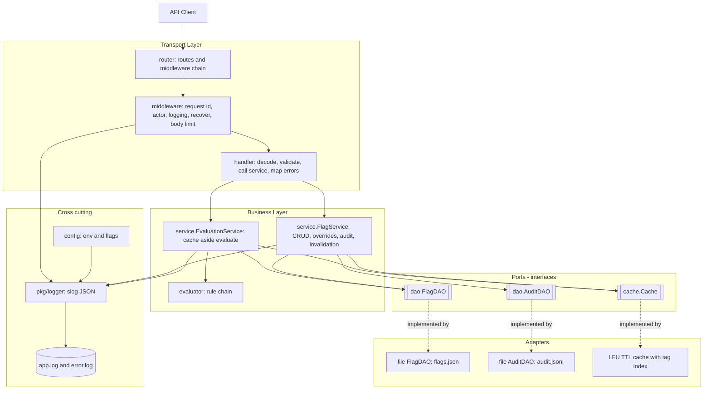
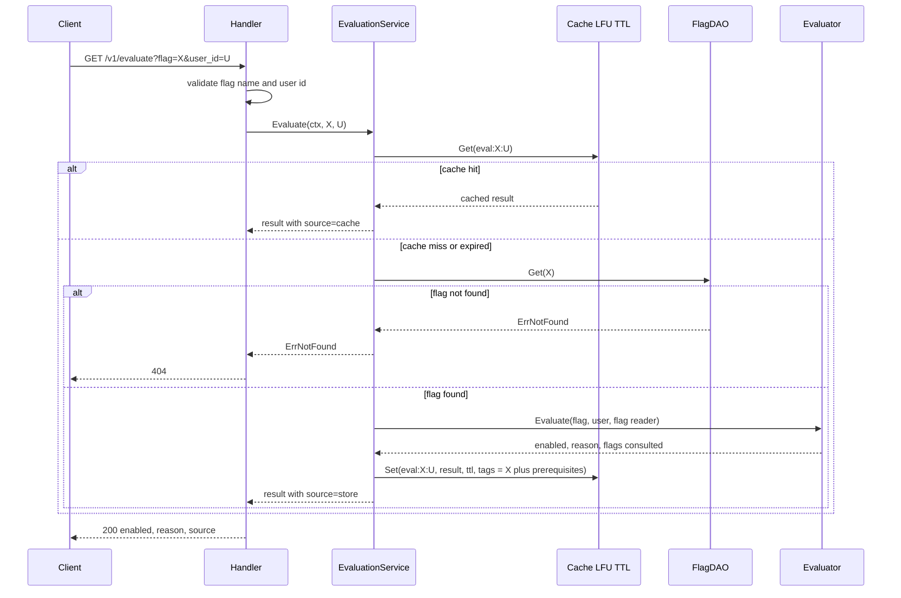
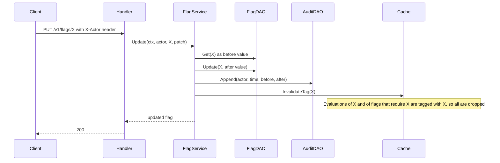
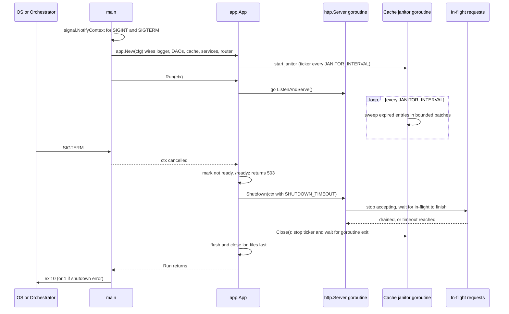

# Feature Flag Service - Engineering Plan (PLAN.md)

## 1. Goals and decisions

Build a production-style REST service in Go that stores feature flags, manages global and per-user state, evaluates flags for a user, caches evaluations, and records an audit trail.

Decisions (revisit only if needed):

- Language and HTTP: Go 1.22+, standard library `net/http` (method and path routing, `r.PathValue`). No web framework.
- Persistence (now): JSON file via a DAO interface. Postgres can replace it later without touching other layers.
- Cache (now): in-memory LFU with per-entry TTL and tag-based invalidation, behind a `Cache` interface.
- Logging: stdlib `log/slog`, JSON output to a log file and stdout, with level separation and request correlation.
- Wiring: constructor-based dependency injection in a single composition root, `internal/app` (`app.New(cfg)`). No globals, no DI framework.
- `cmd/server/main.go` stays minimal (about 25 lines, production style): load config, create a signal-aware context, build the app, run it, and exit non-zero on error. All wiring and lifecycle logic lives in `internal/app`, which keeps it testable.
- Background work: one long-lived goroutine for the cache TTL janitor, and one goroutine for `ListenAndServe`. Both have an explicit stop path and are shut down in a defined order (see 2.4).
- Rule precedence (documented in README): prerequisites -> user override -> global disabled -> percentage rollout -> enabled. Prerequisites are a hard gate even for overrides, so a dependent feature can never be on without its prerequisite. Revisit this if you want overrides to win over everything.

### Why LFU (and why with TTL)

Flag evaluation traffic is highly skewed: a few hot (flag, user) pairs get most of the hits, which is the case LFU is built for. Plain LFU has a known weakness, which is that old entries with high counts never leave. We counter that with a TTL (a safety net and a staleness bound) and explicit invalidation on writes. Complexity is O(1) for get and set using frequency buckets, with no external dependency. LRU and W-TinyLFU (for example `ristretto`) stay as drop-in alternatives because of the `Cache` interface.

## 2. Architecture

### 2.1 Layered view



### 2.2 Evaluation request path (where the cache sits)



Cache bypass cases: a miss, an expired TTL, an invalidated tag, or the request header `Cache-Control: no-cache` (debug aid, logged at debug level). Not-found results are never cached, so a newly created flag is visible immediately.

### 2.3 Write path and cache invalidation



Invalidation strategy (to be explained in the README):

1. Write-through to the store first, then invalidate. A read between the two sees either the old cached value or a fresh recompute, never a corrupted one.
2. Every cached evaluation is tagged with its own flag name and every prerequisite flag it consulted. `InvalidateTag(name)` removes all entries for that flag and for any flag depending on it, with no separate reverse-dependency graph needed.
3. Per-user override changes invalidate the whole flag tag (simple and correct). A finer key delete `eval:X:U` is a possible optimisation.
4. TTL (default 60s) bounds staleness if anything is missed. This also covers the multi-instance case until Redis or pub/sub is added.
5. Delete invalidates the tag too, and deleting a flag that other flags require returns 409.

### 2.4 Process lifecycle: startup, janitor, and graceful shutdown



Shutdown order matters: stop taking traffic first, then drain requests, then stop background workers, and close the logger last so the final lines are written.

## 3. Project structure

```
feature-flag-service/
  cmd/
    server/
      main.go                  # minimal entrypoint only: config, signal context, app.New, app.Run, exit code
  internal/
    app/
      app.go                   # composition root: New(cfg) wires logger -> DAOs -> cache -> services -> handlers -> router -> http.Server
      run.go                   # Run(ctx): ListenAndServe goroutine, wait for signal or failure, ordered graceful shutdown, closers
    config/
      config.go                # env-based config (PORT, DATA_DIR, LOG_DIR, LOG_LEVEL, CACHE_CAPACITY, CACHE_TTL, CACHE_JANITOR_INTERVAL, SHUTDOWN_TIMEOUT, HTTP timeouts)
    domain/
      flag.go                  # Flag, Override, validation rules
      audit.go                 # AuditEntry, Action constants
      errors.go                # ErrNotFound, ErrAlreadyExists, ErrInvalid, ErrConflict
    dao/
      flag_dao.go              # FlagDAO interface
      audit_dao.go             # AuditDAO interface
      file/
        flag_dao.go            # JSON file implementation, RWMutex, atomic temp-file + rename
        audit_dao.go           # append-only JSON lines implementation
      memory/
        flag_dao.go            # in-memory implementation for tests
        audit_dao.go
    evaluator/
      evaluator.go             # Evaluator + Rule interface, result type
      rules.go                 # PrerequisiteRule, OverrideRule, GlobalRule, RolloutRule
    service/
      flag_service.go          # CRUD, overrides, audit, invalidation
      evaluation_service.go    # cache-aside evaluation
    handler/
      flag_handler.go
      evaluate_handler.go
      audit_handler.go
      health_handler.go
      dto.go                   # request and response structs
    middleware/
      request_id.go
      actor.go
      logging.go
      recover.go
      bodylimit.go
    router/
      router.go                # builds http.Handler from handlers + middleware chain
  pkg/
    cache/
      cache.go                 # Cache interface (Get, Set with ttl and tags, Delete, InvalidateTag, Stats)
      lfu/
        lfu.go                 # O(1) LFU with frequency buckets, TTL, tag index
        janitor.go             # background TTL sweeper goroutine, Close() stops it
    logger/
      logger.go                # slog setup: JSON, file and stdout, level split, rotation
      context.go               # logger and request id in context
    httpx/
      response.go              # WriteJSON, WriteError with domain error -> status mapping
  api/
    openapi.yaml               # optional, if time allows
  data/                        # runtime data (gitignored): flags.json, audit.jsonl
  logs/                        # runtime logs (gitignored): app.log, error.log
  .github/workflows/ci.yml
  Dockerfile
  Makefile
  .gitignore
  go.mod
  PLAN.md
  README.md
```

Layering rules (enforced by review):

- `domain` imports nothing from the project.
- `service` depends only on `dao` and `cache` interfaces, never on concrete types or `net/http`.
- `handler` depends only on service interfaces and `httpx`.
- Concrete implementations are chosen only in `internal/app` (called from `cmd/server/main.go`).
- `main.go` contains no business logic, no wiring details, and no goroutines of its own.
- Interfaces are declared next to their consumer's contract (`dao`, `cache`) so fakes are trivial in tests.

## 4. Key contracts

```go
// internal/dao
type FlagDAO interface {
    Create(ctx context.Context, f domain.Flag) error
    Get(ctx context.Context, name string) (domain.Flag, error)
    List(ctx context.Context) ([]domain.Flag, error)
    Update(ctx context.Context, f domain.Flag) error
    Delete(ctx context.Context, name string) error
}

type AuditDAO interface {
    Append(ctx context.Context, e domain.AuditEntry) error
    ListByFlag(ctx context.Context, name string, limit int) ([]domain.AuditEntry, error)
}

// pkg/cache
type Cache interface {
    Get(key string) (any, bool)
    Set(key string, value any, ttl time.Duration, tags ...string)
    Delete(key string)
    InvalidateTag(tag string)
}

// pkg/cache/lfu - the concrete cache also implements io.Closer (stops the janitor)
type Config struct {
    Capacity        int
    DefaultTTL      time.Duration
    JanitorInterval time.Duration // 0 disables the janitor (useful in tests)
    SweepBatchSize  int           // entries scanned per lock hold, so the sweep never blocks readers for long
    Clock           func() time.Time // injectable for tests
}
func New(cfg Config, log *slog.Logger) *Cache
func (c *Cache) SweepNow() int // removes expired entries, returns count (used by janitor and tests)
func (c *Cache) Close() error  // idempotent (sync.Once): stops the ticker, waits for the goroutine

// internal/evaluator
type Rule interface {
    Apply(ctx context.Context, in Input) (decision *Decision, err error) // nil decision = continue to next rule
}
```

Domain model:

```go
type Flag struct {
    Name           string          // ^[a-zA-Z0-9][a-zA-Z0-9_.-]{0,63}$ (no spaces, max 64)
    Description    string          // max 256
    Enabled        bool            // global state
    Overrides      map[string]bool // userID -> enabled
    RolloutPercent int             // 0..100, default 100 (extension)
    Requires       []string        // prerequisite flag names (extension)
    Version        int64
    CreatedAt      time.Time
    UpdatedAt      time.Time
}

type AuditEntry struct {
    ID        string
    FlagName  string
    Actor     string          // from X-Actor header
    Action    string          // flag.created, flag.updated, flag.deleted, override.set, override.removed
    Before    json.RawMessage // null on create
    After     json.RawMessage // null on delete
    RequestID string
    At        time.Time
}
```

## 5. REST API

- POST `/v1/flags` - create (201, 400 invalid, 409 duplicate)
- GET `/v1/flags` - list (200)
- GET `/v1/flags/{name}` - read (200, 404)
- PUT `/v1/flags/{name}` - update description, enabled, and later rollout and requires (200, 400, 404)
- DELETE `/v1/flags/{name}` - delete (204, 404, 409 if required by others)
- PUT `/v1/flags/{name}/overrides/{userId}` - set override, body `{"enabled": true}` (200, 400, 404)
- DELETE `/v1/flags/{name}/overrides/{userId}` - remove override (204, 404)
- GET `/v1/evaluate?flag=X&user_id=U` - response `{"flag":"X","user_id":"U","enabled":true,"reason":"user_override","source":"cache|store"}` (200, 400, 404)
- GET `/v1/flags/{name}/audit?limit=50` - audit trail (200, 404)
- GET `/healthz` and `/readyz` - health checks

Conventions: writes require the `X-Actor` header (400 if missing). A client-supplied `X-Request-ID` is accepted or generated and echoed back. Errors use a single JSON shape `{"error":{"code":"not_found","message":"...","request_id":"..."}}`. Unknown JSON fields are rejected, and request bodies are limited to 1 MB. Domain errors map to 400, 404, 409, or 500 in `httpx.WriteError`, and an unexpected error never leaks internals.

## 6. Logging design (`pkg/logger`)

- Built on `log/slog` with a JSON handler. Output goes to `logs/app.log` and stdout, and records at warn and above also go to `logs/error.log`.
- Levels: DEBUG (cache hit or miss detail, rule decisions, DAO calls), INFO (request completed, flag changed, startup and shutdown), WARN (validation failures, 4xx, cache bypass, slow requests), ERROR (5xx, DAO failures, panics with stack).
- Level is controlled by `LOG_LEVEL`, with `info` as the production default.
- Every request log line carries: `time`, `level`, `request_id`, `actor` (user name from `X-Actor`, or `anonymous`), `method`, `path`, `status`, `duration_ms`, `remote_addr`, and `user_id` for evaluate calls.
- Request-scoped logger: the middleware builds a child logger with `request_id` and `actor` and stores it in the context. Services and DAOs call `logger.FromContext(ctx)`, so the whole trace of a user request is correlated by `request_id`.
- Rotation via `lumberjack` (size and age limits) or `logrotate` documented in the README.
- Never log secrets or full request bodies.

## 7. Evaluation rules

Rule chain, evaluated in order (each rule can return a decision or pass to the next):

1. Flag missing -> `ErrNotFound` (404).
2. PrerequisiteRule (extension) - if any required flag is not enabled for this user -> false, reason `prerequisite_failed`. Uses a cycle-safe depth limit.
3. OverrideRule - if the user has an override, return it, reason `user_override`.
4. GlobalRule - if the flag is globally disabled -> false, reason `global_off`.
5. RolloutRule (extension) - `fnv32a(flagName + ":" + userID) % 100 < RolloutPercent` -> true, otherwise false, reason `rollout_in` or `rollout_out`.
6. Default -> true, reason `global_on`.

The evaluator is pure (inputs in, decision out), so the unit tests need no I/O. Adding the extensions means adding rules, not editing existing ones.

## 8. Tickets

Priority: P0 = required, P1 = required deliverable, P2 = extension. Work them in order; each ticket should end with `go build ./...` and `go test ./...` passing and a commit.

### FFS-1 Project scaffolding (P0) - first
- Initialise `go.mod`, create the folder tree from section 3 with `.gitkeep` or stub files, `.gitignore` (`data/`, `logs/`, binaries), `Makefile` (`run`, `test`, `lint`, `build`), and write this plan to `PLAN.md`.
- `cmd/server/main.go` is created in its final minimal shape (see "Target main.go" below). At this stage `internal/app` only builds a bare router with `/healthz`.
- Done when: `make run` serves `/healthz`, and the layout matches this document.

Target `main.go` (the whole file, about 25 lines):

```go
package main

import (
    "context"
    "fmt"
    "os"
    "os/signal"
    "syscall"

    "feature-flag-service/internal/app"
    "feature-flag-service/internal/config"
)

func main() {
    if err := run(); err != nil {
        fmt.Fprintln(os.Stderr, "fatal:", err)
        os.Exit(1)
    }
}

func run() error {
    ctx, stop := signal.NotifyContext(context.Background(), os.Interrupt, syscall.SIGTERM)
    defer stop() // after the first signal, a second Ctrl-C force-quits

    cfg, err := config.Load()
    if err != nil {
        return err
    }
    a, err := app.New(cfg)
    if err != nil {
        return err
    }
    return a.Run(ctx)
}
```

Why this shape: `main` only maps errors to an exit code. `run()` returns errors so deferred cleanup always executes (calling `os.Exit` or `log.Fatal` inside the logic would skip defers). Everything else is testable inside `internal/app`.

### FFS-2 Config and logging (P0)
- `internal/config` loads env vars with defaults and validation.
- `pkg/logger` implements the file and stdout JSON handlers, the level split, `error.log`, rotation, and context helpers.
- Done when: log lines in `logs/app.log` contain time, level, and the request fields, and a unit test checks level filtering.

### FFS-3 Domain and validation (P0)
- `domain.Flag`, `AuditEntry`, sentinel errors, and `Flag.Validate()` (name regex, max lengths, rollout range).
- Unit tests for valid and invalid names (empty, spaces, too long, illegal characters).

### FFS-4 DAO layer (P0)
- `FlagDAO` and `AuditDAO` interfaces, a file implementation (load on start, `sync.RWMutex`, atomic temp-file + rename on write, append-only `audit.jsonl`), and an in-memory implementation for tests.
- Shared DAO contract tests run against both implementations.
- Done when: data survives a restart, and concurrent access passes with `go test -race`.

### FFS-5 LFU cache (P0)
- `pkg/cache` interface and `pkg/cache/lfu`: O(1) get and set via frequency buckets and a doubly linked list, capacity eviction, per-entry TTL with lazy expiry on `Get`, tag index with `InvalidateTag`, and thread safety.
- TTL janitor (`janitor.go`): a background goroutine started by `lfu.New` when `JanitorInterval > 0`.
  - Why: lazy expiry alone leaves entries that are never read again in memory until LFU evicts them, and a stale low-frequency entry may sit a long time.
  - How: `time.Ticker` loop with `select` on `ticker.C` and a `stop` channel. Each tick calls `SweepNow()`, which scans entries in batches of `SweepBatchSize`, releasing the lock between batches so `Get` and `Set` are never blocked for long. Removing an entry also removes it from the frequency bucket and the tag index.
  - Lifecycle: the goroutine is tracked with a `sync.WaitGroup`. `Close()` is idempotent (`sync.Once`), closes `stop`, and waits for the goroutine to exit. The goroutine recovers from panics, logs them at error level, and keeps running.
  - Logging: debug level line per sweep with `expired_count`, `remaining`, and `duration_ms`. Nothing is logged when zero entries expire.
  - Config: `CACHE_JANITOR_INTERVAL` (default 30s, 0 disables).
- Unit tests: eviction order by frequency (and by recency on ties), TTL expiry (injectable clock), tag invalidation, a `-race` concurrency test, `SweepNow()` removes only expired entries and cleans the tag index, the janitor removes expired entries without any `Get`, and `Close()` stops the goroutine (verified with a goroutine count check or `goleak`) and can be called twice safely.

### FFS-6 Evaluator (P0)
- `Evaluator`, the `Rule` interface, and `OverrideRule`, `GlobalRule`, with the rule chain wired in order.
- Required unit tests: global on, global off, override on over global off, override off over global on, user without an override uses global, and flag not found.

### FFS-7 Services (P0)
- `FlagService`: create, get, list, update, delete, set or remove override. Each write builds before and after snapshots, writes via the DAO, appends the audit entry (actor, time, before, after, request id), then invalidates the cache tag.
- `EvaluationService`: cache-aside using key `eval:{flag}:{user}`, tagged with the flag and consulted prerequisites, and no caching of errors.
- Unit tests with the in-memory DAOs and a spy cache: a write invalidates, a hit skips the DAO, and audit entries have correct before and after values.

### FFS-8 HTTP layer (P0)
- `router` with Go 1.22 patterns, middleware chain (recover -> request id -> actor -> logging -> body limit), handlers, DTOs, `httpx` response and error mapping.
- Done when: every endpoint in section 5 returns the documented status codes, and a missing flag returns 404.

### FFS-8A Application bootstrap and graceful shutdown (P0)
Implements `internal/app` and the lifecycle in section 2.4. Work it right after FFS-8.

- `app.New(cfg) (*App, error)`: the single composition root. It builds the logger, DAOs, cache, services, handlers, router, and `http.Server`, and registers every resource with a `Close` in a closer list (`[]io.Closer`) in creation order. It sets `http.Server` timeouts (`ReadHeaderTimeout`, `ReadTimeout`, `WriteTimeout`, `IdleTimeout`) from config, which also protects against slowloris.
- `app.Run(ctx) error`:
  1. Start `ListenAndServe` in its own goroutine. Report any error other than `http.ErrServerClosed` on a buffered `errCh`.
  2. `select` on `ctx.Done()` (SIGINT or SIGTERM) and `errCh` (the server failed, for example the port is in use).
  3. On shutdown: log "shutdown signal received", flip a readiness flag (`atomic.Bool`) so `/readyz` returns 503 and the orchestrator stops routing new traffic, then call `srv.Shutdown(ctxWithTimeout)` with `SHUTDOWN_TIMEOUT` (default 10s) to drain in-flight requests.
  4. If the drain times out, log a warning and call `srv.Close()` to force it.
  5. Close the closers in reverse creation order: cache (stops the janitor), then the logger last so the final lines reach the file.
  6. Return the first meaningful error so `main` can set the exit code.

```go
func (a *App) Run(ctx context.Context) error {
    errCh := make(chan error, 1)
    go func() {
        a.log.Info("server listening", "addr", a.srv.Addr)
        if err := a.srv.ListenAndServe(); !errors.Is(err, http.ErrServerClosed) {
            errCh <- err
        }
    }()

    select {
    case err := <-errCh:
        a.closeAll()
        return fmt.Errorf("server failed: %w", err)
    case <-ctx.Done():
    }

    a.log.Info("shutdown signal received")
    a.ready.Store(false)
    shutdownCtx, cancel := context.WithTimeout(context.Background(), a.cfg.ShutdownTimeout)
    defer cancel()
    err := a.srv.Shutdown(shutdownCtx)
    if err != nil {
        a.log.Warn("graceful shutdown timed out, forcing close", "err", err)
        _ = a.srv.Close()
    }
    a.closeAll()
    return err
}
```

- Config additions: `SHUTDOWN_TIMEOUT`, `HTTP_READ_HEADER_TIMEOUT`, `HTTP_READ_TIMEOUT`, `HTTP_WRITE_TIMEOUT`, `HTTP_IDLE_TIMEOUT`.
- Tests:
  - Start the app on a random port (`:0`) in a goroutine, send a request, cancel the context, and assert `Run` returns nil.
  - A slow in-flight request (a test handler that sleeps) still completes during shutdown, and a new request after shutdown starts is refused.
  - `/readyz` returns 503 once shutdown begins.
  - The janitor goroutine is gone after `Run` returns.
  - Starting on an occupied port makes `Run` return an error.
- Done when: `kill -TERM <pid>` on the running binary logs the shutdown sequence, finishes in-flight work, and exits with code 0, and `go test -race` is clean.

### FFS-9 Tests (P1)
- Integration test with `httptest.NewServer` and real file DAOs in `t.TempDir()`: create, evaluate (off), set override, evaluate (on, reason `user_override`), evaluate again (`source=cache`), update, evaluate (invalidated), read audit trail, delete, evaluate returns 404, and a validation failure returns 400.
- Handler tests for error mapping and validation edge cases.

### FFS-10 CI (P1)
- `.github/workflows/ci.yml` on push and pull request: setup-go, `go vet ./...`, `gofmt` check, `go test -race -cover ./...`, and `go build ./...`.

### FFS-11 Documentation (P1)
- README: overview, setup and run, configuration table, API reference with curl examples, evaluation rules, caching (LFU choice, key format, tags, TTL, invalidation strategy, multi-instance caveat), logging, audit trail, project layout, the architecture diagrams from section 2, testing, and future work.

### FFS-12 Percentage rollout (P2)
- Add `RolloutPercent` to the flag and the API, plus the `RolloutRule` using fnv32a bucketing.
- Tests: determinism (same user, same answer), 0 and 100 edge cases, and approximate distribution over 10k generated user ids.

### FFS-13 Flag dependencies (P2)
- Add `Requires` to the flag and API, plus the `PrerequisiteRule`.
- On write: reject unknown prerequisites (400), reject cycles with DFS (409), and block deleting a flag that others require (409).
- Tag-based invalidation already covers dependents. Tests: prerequisite off makes the dependent false, a cycle is rejected, and changing the prerequisite invalidates the dependent's cache.

### FFS-14 Containerisation and DigitalOcean deploy (P2)
- Multi-stage `Dockerfile` (distroless or alpine, non-root user, volume for `data/` and `logs/`). Use the exec form of `ENTRYPOINT` so the Go process is PID 1 and receives SIGTERM directly, which the graceful shutdown in FFS-8A depends on. Set the platform's stop timeout above `SHUTDOWN_TIMEOUT`.
- Deploy to DigitalOcean App Platform (from GitHub) or a Droplet. Document the steps in the README and note that file storage needs a persistent volume or a later DB swap, because App Platform's filesystem is ephemeral.
- Done when: a public `/healthz` and a working evaluate call are documented.

## 9. Future enhancements (design hooks already in place)

- Postgres `FlagDAO` and `AuditDAO` (same interfaces, add to the composition root).
- Redis or pub/sub invalidation for multi-instance deployments (new `Cache` implementation).
- W-TinyLFU or LRU as alternative caches.
- API key or JWT auth replacing the `X-Actor` header, with RBAC.
- Metrics (Prometheus), tracing (OpenTelemetry), and rate limiting.
- Additional rules (targeting by attributes, scheduled enablement) as new `Rule` implementations.
