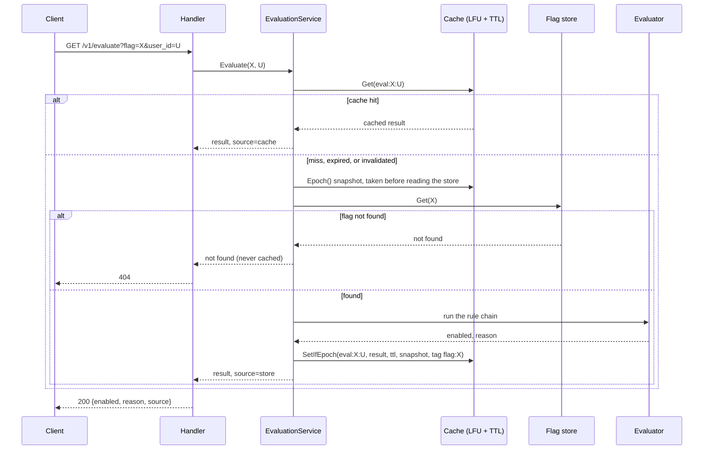
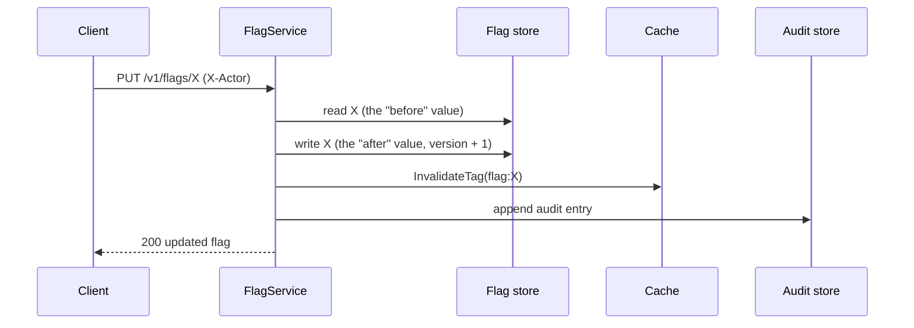
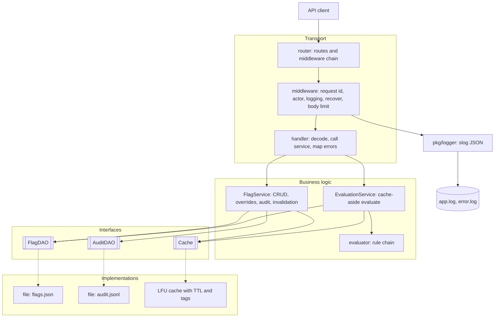
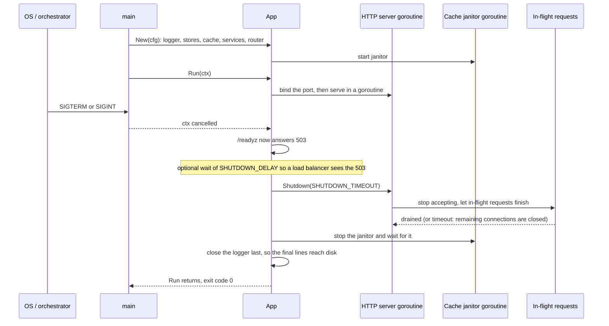

# Feature Flag Service

A REST service, written in Go with only the standard library, that stores feature flags, manages their state globally and per user, and tells you whether a feature is on for a given user. Evaluations are cached in memory so they stay fast, and every change is recorded in an audit trail.

- **Flags:** create, read, update, delete. Each has a name, a description, a global on/off state, an optional rollout percentage and optional per-user overrides.
- **Evaluation:** `GET /v1/evaluate?flag=X&user_id=U` answers `enabled` plus the reason. A per-user override beats the global state, and an enabled flag can be limited to a percentage of users. See [Percentage rollout](#percentage-rollout).
- **Caching:** an in-memory LFU cache with a time limit (TTL), invalidated precisely when a flag changes. See [Caching](#caching).
- **Audit trail:** who changed what, when, with the previous and the new value. See [Audit trail](#audit-trail).
- **Production behaviour:** structured JSON logs with request ids, graceful shutdown, crash-safe file storage, and no data races (the tests run under `-race`).

Planned but **not built yet**: flag dependencies (prerequisite flags) and the Docker/DigitalOcean deployment. See [Roadmap](#roadmap).

## Contents

1. [Quick start](#quick-start)
2. [How a flag is evaluated](#how-a-flag-is-evaluated) and [Percentage rollout](#percentage-rollout)
3. [Caching](#caching)
4. [Architecture](#architecture)
5. [API reference](#api-reference)
6. [Audit trail](#audit-trail)
7. [Logging](#logging)
8. [Configuration](#configuration)
9. [Storage and durability](#storage-and-durability)
10. [Concurrency model](#concurrency-model)
11. [Lifecycle and graceful shutdown](#lifecycle-and-graceful-shutdown)
12. [Testing and CI](#testing-and-ci)
13. [Project layout](#project-layout)
14. [Roadmap](#roadmap)

## Quick start

You need Go 1.22 or newer.

```bash
make run                      # or: go run ./cmd/server
```

The server listens on port 8080 and writes `data/flags.json`, `data/audit.jsonl` and `logs/*.log` relative to the working directory. Everything is configurable with environment variables; see [Configuration](#configuration).

Try it. Writes need an `X-Actor` header naming who is making the change.

```bash
# Create a flag. It starts disabled.
curl -i -X POST localhost:8080/v1/flags \
  -H 'X-Actor: alice' -H 'Content-Type: application/json' \
  -d '{"name":"new-checkout","description":"Redesigned checkout flow"}'

# Evaluate it for a user: off for everyone, answered from the store...
curl 'localhost:8080/v1/evaluate?flag=new-checkout&user_id=u42'
# {"flag":"new-checkout","user_id":"u42","enabled":false,"reason":"global_off","source":"store"}

# ...and from the cache the second time.
curl 'localhost:8080/v1/evaluate?flag=new-checkout&user_id=u42'
# {"flag":"new-checkout","user_id":"u42","enabled":false,"reason":"global_off","source":"cache"}

# Turn it on for one user only.
curl -X PUT localhost:8080/v1/flags/new-checkout/overrides/u42 \
  -H 'X-Actor: alice' -H 'Content-Type: application/json' -d '{"enabled":true}'
curl 'localhost:8080/v1/evaluate?flag=new-checkout&user_id=u42'
# {"flag":"new-checkout","user_id":"u42","enabled":true,"reason":"user_override","source":"store"}
curl 'localhost:8080/v1/evaluate?flag=new-checkout&user_id=u7'
# {"flag":"new-checkout","user_id":"u7","enabled":false,"reason":"global_off","source":"store"}

# Turn it on for everyone.
curl -X PUT localhost:8080/v1/flags/new-checkout \
  -H 'X-Actor: bob' -H 'Content-Type: application/json' -d '{"enabled":true}'
curl 'localhost:8080/v1/evaluate?flag=new-checkout&user_id=u7'
# {"flag":"new-checkout","user_id":"u7","enabled":true,"reason":"global_on","source":"store"}

# See who did what.
curl 'localhost:8080/v1/flags/new-checkout/audit'
```

Notice that `source` flips to `store` right after each change: the write invalidated the cached answers, so the next evaluation recomputed from the flag.

Other useful commands:

| Command | What it does |
| --- | --- |
| `make test` | all tests |
| `make test-race` | all tests with the race detector and coverage |
| `make integration` | a curl-based end-to-end script that starts its own server (see `sample_test/`) |
| `make ci` | exactly what the CI pipeline runs |
| `make build` | a static binary in `bin/feature-flag-service` |
| `make lint` | `gofmt` check and `go vet` |

## How a flag is evaluated

Given a flag and a user, the rules run in order and the first one that applies decides:

| Order | Rule | Applies when | Result | `reason` |
| --- | --- | --- | --- | --- |
| 1 | User override | the user has an override on this flag | the override's value, whatever the global state is | `user_override` |
| 2 | Global off | the flag is globally disabled | off | `global_off` |
| 3 | Rollout | the flag is enabled but `rollout_percent` is below 100 | on for the users whose bucket falls inside the percentage, off for the rest | `rollout_included` or `rollout_excluded` |
| 4 | Global on | the flag is globally enabled (and not limited by a rollout) | on | `global_on` |

So an override can turn a feature **on** for one user while it is globally off (a beta tester), or **off** for one user while it is globally on or outside the rollout (an opt-out). Overrides do not depend on each other and do not affect other users. A flag at 100% (the default) skips the rollout rule and reports `global_on`, exactly as before the rollout existed.

An unknown flag is a `404`, never a `500` and never "off".

The rules are a chain of small objects behind one `Rule` interface (`internal/evaluator`). Percentage rollout was added as a new rule between global off and global on without changing the evaluator or the other rules, and prerequisites will be added the same way (see the [Roadmap](#roadmap)).

### Percentage rollout

Set `rollout_percent` (a whole number from 0 to 100) to turn an **enabled** flag on for only a share of users:

```bash
curl -X POST localhost:8080/v1/flags -H 'X-Actor: alice' -H 'Content-Type: application/json' \
  -d '{"name":"new-search","enabled":true,"rollout_percent":10}'
curl -X PUT localhost:8080/v1/flags/new-search -H 'X-Actor: alice' -H 'Content-Type: application/json' \
  -d '{"rollout_percent":25}'
```

- **Which users:** each user gets a stable position for each flag, `bucket = SHA-256(flag + NUL + user) mod 10000`. The user is in when `bucket < rollout_percent * 100`. Ten thousand buckets means one bucket per 0.01% of users.
- **Deterministic:** the same flag and user always land in the same bucket, in every process and every release, so a user's experience never flickers. A test pins known bucket values, because changing the hash would silently move users in and out of every running rollout.
- **Monotonic:** raising the percentage only ever adds users and lowering it only removes users; nobody is swapped. Going from 10% to 25% keeps everyone who was already in.
- **Independent per flag:** the flag name is part of the hash, so each flag gets its own cohort and the same 10% of users are not the guinea pigs for every experiment.
- **Order of rules:** override, then global off, then rollout, then global on. An override beats the rollout in both directions, and a globally disabled flag is off whatever its percentage is (the percentage is kept, so enabling the flag again resumes the rollout where it was).
- **Defaults and edges:** a flag with no `rollout_percent` is at 100, which is the same as no rollout. 0 is on for nobody except users with an override. Values outside 0 to 100, fractions and non-numbers are a `400 invalid_request`.
- **Why SHA-256:** the first plan used FNV-1a, which is cheaper. Measured on 100,000 zero-padded sequential ids it spread users visibly unevenly (chi-square 218 against an expected 99 for a uniform hash) and correlated the cohorts of different flags. SHA-256 measured at the expected value. Its cost does not matter here because answers are cached.
- **Cache:** a rollout change is an ordinary flag update, so it invalidates the flag's cached answers like any other write.

## Caching

Evaluation is the hot path: it is called far more often than flags change, and the answer for one `(flag, user)` pair rarely changes. So each answer is cached.

- **What is cached:** the result of one evaluation, under the key `eval:{flag}:{user}`. Each entry is tagged `flag:{name}` with the flag it depends on.
- **Where it sits:** between the evaluation endpoint and the flag store. It is *not* in front of writes or flag reads: `GET /v1/flags/{name}` always reads the store.
- **Which cache:** an in-memory **LFU** (least frequently used) with a per-entry time limit. Traffic is skewed, with a few hot flag and user pairs taking most of the hits, which is what LFU keeps. Plain LFU lets old entries with high counts linger forever, so every entry also expires after `CACHE_TTL`. Get, set and delete are O(1).
- **Capacity:** `CACHE_CAPACITY` entries. When it is full, the entry used least often is evicted (the least recently used one among ties). Eviction costs speed, never correctness.
- **Janitor:** a background goroutine removes expired entries every `CACHE_JANITOR_INTERVAL`, in small batches so it never holds the lock for long. It stops cleanly on shutdown.

### When the cache is consulted, bypassed and invalidated



| Situation | What happens |
| --- | --- |
| The answer is cached and fresh | **Consulted, hit.** Returned with `source=cache`, no store read. |
| First evaluation, or the entry was evicted | **Consulted, miss.** Computed from the store, then cached. |
| The entry is older than `CACHE_TTL` | **Treated as a miss.** Recomputed and cached again. |
| The flag was created, updated, deleted, or an override changed | **Invalidated** (below), so the next evaluation recomputes. |
| The flag does not exist | **Never cached.** A flag created later is visible immediately. |
| A write changes nothing (same value as before) | **Not invalidated.** Nothing changed, so cached answers are still right. |
| Any error | **Never cached.** |

### Invalidation strategy

Writes use this order, under a lock held for that one flag (see [Concurrency model](#concurrency-model)):



1. **Store first, then invalidate.** A reader between the two steps sees the old cached value or a fresh recompute, never a corrupted one.
2. **Invalidate by tag.** Every cached answer carries its flag's tag, so one `InvalidateTag(flag:X)` drops every user's answer for X and leaves other flags untouched. Changing an override invalidates the whole flag; that is simple and correct, and finer-grained deletes are a possible optimisation.
3. **TTL is the safety net.** Even if an invalidation were ever missed, no answer can be stale for longer than `CACHE_TTL` (default 60 seconds).
4. **Stale-fill protection.** The subtle race in any cache-aside design: a reader loads the old flag, a writer changes it and invalidates, then the reader stores its old answer, which would now be served until the TTL. To prevent it, the reader takes a snapshot (`Epoch()`) *before* reading the store and stores with `SetIfEpoch`, which refuses if any invalidation happened in between. The counter advances even when nothing was cached under the tag, because the write may predate any cached entry.
5. **Read your writes.** The result of 3 and 4 together: once a write has been acknowledged, the next evaluation sees it. This is tested end to end, with background readers keeping the cache hot while a writer toggles a flag.

**Multiple instances.** The cache is per process. With more than one instance, a write invalidates only the instance that handled it; the others serve their cached answer for up to `CACHE_TTL`. Run a single instance, or lower the TTL, until a shared cache (Redis) or pub/sub invalidation is added. The cache sits behind an interface (`pkg/cache`), so swapping it is a local change.

## Architecture



The business logic depends only on small interfaces it defines itself, never on concrete storage, the cache or `net/http`. A single composition root (`internal/app`) is the only place that chooses concrete types, so swapping the JSON files for Postgres, or the in-memory cache for Redis, touches one constructor. `cmd/server/main.go` is about 35 lines: load config, create a signal-aware context, build the app, run it.

The design follows SOLID throughout, in concrete ways: handlers each take their own narrow interface, the DAOs are split into reader and writer halves, the evaluator is an open chain of rules, and one shared contract test suite runs against every DAO implementation. `PLAN.md` explains each decision.

## API reference

| Method and path | Purpose | Success | Errors |
| --- | --- | --- | --- |
| `POST /v1/flags` | create a flag (`name`, `description`, `enabled`, `rollout_percent`) | 201 | 400, 409 |
| `GET /v1/flags` | list flags | 200 | |
| `GET /v1/flags/{name}` | read one flag | 200 | 404 |
| `PUT /v1/flags/{name}` | update `description`, `enabled` and/or `rollout_percent` | 200 | 400, 404 |
| `DELETE /v1/flags/{name}` | delete a flag | 204 | 404 |
| `PUT /v1/flags/{name}/overrides/{userId}` | set a user's override, body `{"enabled": true}` | 200 | 400, 404 |
| `DELETE /v1/flags/{name}/overrides/{userId}` | remove it | 204 | 404 (flag or override missing) |
| `GET /v1/evaluate?flag=X&user_id=U` | evaluate | 200 | 400, 404 |
| `GET /v1/flags/{name}/audit?limit=50` | change history, newest first | 200 | 400 |
| `GET /healthz` | liveness: the process is up | 200 | |
| `GET /readyz` | readiness: 200 normally, 503 while shutting down | 200 | 503 |

**Flag names** are 1 to 64 characters of letters, digits, `_`, `.` or `-`, starting with a letter or digit. **No spaces.** Descriptions are at most 256 characters. User ids are 1 to 128 characters with no whitespace or control characters.

**Updates are partial**: a field you leave out is unchanged. A new flag starts **disabled** unless you say otherwise, and at a **100%** rollout unless you give `rollout_percent`. An override requires `enabled`.

**Writes that change nothing are no-ops.** Repeating an update or override is acknowledged with 200, but it does not change the version, add an audit entry or invalidate the cache.

### Headers

- **`X-Actor`**: required on every write (POST, PUT, DELETE); otherwise `400 missing_actor`. It is the name recorded in the audit trail and the logs. Reads without it are logged as `anonymous`.
- **`X-Request-ID`**: optional. If you send one (up to 64 characters of letters, digits, `-`, `_`, `.`), it is used; otherwise one is generated. Anything else is replaced, so a client cannot inject newlines into the logs. The id is echoed in the response header, in every error body, in the access log and in the audit record.

### Errors

Every error has the same shape, including unknown routes and wrong methods (which also carry an `Allow` header):

```json
{"error":{"code":"not_found","message":"not found: flag \"nope\"","request_id":"3d6855db5376094a14989766f2de3e74"}}
```

| Status | `code` | When |
| --- | --- | --- |
| 400 | `invalid_request` | bad name, bad JSON, unknown field, missing `enabled` or query parameter, `rollout_percent` outside 0 to 100 |
| 400 | `missing_actor`, `invalid_actor` | write without `X-Actor`, or an invalid one |
| 404 | `not_found` | unknown flag (or override), unknown route |
| 405 | `method_not_allowed` | wrong method for a known path |
| 409 | `already_exists` | creating a flag that exists |
| 409 | `conflict` | the flag was changed by someone else mid-update (retried internally first) |
| 413 | `body_too_large` | body larger than 1 MiB |
| 415 | `unsupported_media_type` | body is not `application/json` |
| 499 | `client_closed_request` | the client went away before the request finished |
| 500 | `audit_failed` | the change was saved but its audit entry could not be written (logged at ERROR) |
| 500 | `internal` | anything unexpected. The message is fixed; the real cause is logged with the request id and never sent to the client. |
| 504 | `timeout` | the request ran out of time |

A missing flag is always a `404`, on every route that takes a flag name.

### Response bodies

```json
{
  "name": "new-checkout",
  "description": "Redesigned checkout flow",
  "enabled": true,
  "overrides": { "u42": true },
  "rollout_percent": 100,
  "version": 3,
  "created_at": "2026-11-21T09:43:20.347543261Z",
  "updated_at": "2026-11-21T09:43:20.378067222Z"
}
```

`version` starts at 1 and increases by one with every change. `rollout_percent` is always present in responses, 100 when no rollout is set. The evaluation response is `{"flag","user_id","enabled","reason","source"}` where `reason` is `user_override`, `global_off`, `rollout_included`, `rollout_excluded` or `global_on`, and `source` is `cache` or `store`. The list response is `{"flags":[...]}`.

## Audit trail

Every change appends one record: flag created, updated or deleted, override set or removed.

```json
{
  "id": "dcc8bec9713d7deff1f9d022fbfbec6d",
  "flag_name": "new-checkout",
  "actor": "bob",
  "action": "flag.updated",
  "before": { "name": "new-checkout", "enabled": false, "overrides": { "u42": true }, "version": 2, "...": "..." },
  "after":  { "name": "new-checkout", "enabled": true,  "overrides": { "u42": true }, "version": 3, "...": "..." },
  "request_id": "ad8b04f40af3fbc2a5578aa5c5752363",
  "at": "2026-11-21T09:43:20.378627549Z"
}
```

- **Who, when, what:** `actor`, `at`, and the full flag before and after. `before` is `null` for a creation and `after` is `null` for a deletion.
- **Traceable:** the `request_id` links the record to the access-log line of the request that made the change.
- **Newest first**, 50 entries by default, at most 1000 (`?limit=`).
- **Survives deletion.** Deleting a flag adds a `flag.deleted` entry, and the history stays readable. An unknown flag returns an empty list, not a 404.
- **Append-only** (`data/audit.jsonl`, one JSON object per line, flushed to disk on every write).
- **Ordering guarantee:** within one flag, entries replay in version order, and each entry starts from exactly where the previous one ended.
- **If the audit write fails** after the change was saved, the change is *not* rolled back; the request returns `500 audit_failed` and the failure is logged at ERROR with the full entry, so it can be recovered from the log.

## Logging

Built on `log/slog`, written as one JSON object per line to three places:

| Destination | Contains |
| --- | --- |
| `logs/app.log` | everything at or above `LOG_LEVEL` |
| `logs/error.log` | warn and error records only, for quick triage |
| stdout | the same as `app.log`, for container log collectors |

Files rotate by size and age (`LOG_MAX_SIZE_MB`, `LOG_MAX_BACKUPS`, `LOG_MAX_AGE_DAYS`).

**Levels:** `debug` (cache hit and miss detail), `info` (a request completed, startup and shutdown), `warn` (client errors such as 400 and 404, slow requests), `error` (5xx responses, failed audit writes, panics with a stack trace). Client mistakes are warnings on purpose, so an `error`-level record always means a real server fault.

**Every request** produces one line carrying the whole trace of the call:

```json
{"time":"2026-11-21T09:43:20.350645758Z","level":"info","msg":"request completed","service":"feature-flag-service","request_id":"1ca5246e849fef701cc6a8f8b884ac0a","actor":"alice","method":"POST","path":"/v1/flags","status":201,"duration_ms":3.19,"bytes":200,"remote_addr":"[::1]:39084"}
```

`time`, `request_id` and `actor` (the user name from `X-Actor`) appear on every request-scoped line, including lines logged deep inside the services. To follow one request, `grep` its id; it is also in the response header and the audit record. A request that panics still gets an access line with status 500, and the client sees a clean JSON 500.

## Configuration

All settings are environment variables. Invalid values stop the server at startup with a clear message (`fatal: config: ...`, exit code 1).

| Variable | Default | Meaning |
| --- | --- | --- |
| `PORT` | `8080` | listen port (1 to 65535) |
| `DATA_DIR` | `data` | where `flags.json` and `audit.jsonl` live |
| `LOG_DIR` | `logs` | where `app.log` and `error.log` live |
| `LOG_LEVEL` | `info` | `debug`, `info`, `warn` or `error` |
| `LOG_MAX_SIZE_MB` | `50` | rotate a log file at this size |
| `LOG_MAX_BACKUPS` | `5` | rotated files to keep |
| `LOG_MAX_AGE_DAYS` | `30` | delete rotated files older than this |
| `CACHE_CAPACITY` | `10000` | maximum cached evaluations |
| `CACHE_TTL` | `60s` | longest an evaluation may be served from the cache |
| `CACHE_JANITOR_INTERVAL` | `30s` | how often expired entries are swept (`0` disables the sweeper) |
| `SHUTDOWN_TIMEOUT` | `10s` | how long in-flight requests get to finish on shutdown |
| `SHUTDOWN_DELAY` | `0s` | how long to report "not ready" before closing the listener (see below) |
| `HTTP_READ_HEADER_TIMEOUT` | `5s` | time to read request headers (protects against slow clients) |
| `HTTP_READ_TIMEOUT` | `15s` | time to read a whole request |
| `HTTP_WRITE_TIMEOUT` | `15s` | time to write a response |
| `HTTP_IDLE_TIMEOUT` | `60s` | how long an idle keep-alive connection is kept |

Durations use Go syntax (`500ms`, `30s`, `2m`).

## Storage and durability

Storage sits behind two interfaces (`FlagDAO`, `AuditDAO`). The shipped implementations are plain files; Postgres can replace them without touching any other layer.

- **`flags.json`** holds all flags. Every write goes to a temporary file in the same directory, is flushed to disk, then renamed over the old file, so a crash leaves either the old file or the new one, never a half-written one. Stray temporary files from a crash are ignored.
- **`audit.jsonl`** is append-only and flushed on every append. If a crash leaves a half-written last line, it is skipped when reading and the next append starts on a fresh line.
- **Restarts** lose nothing but the cache, which starts cold and refills.
- **Files are private** (mode 0600) and the service is the only intended writer.

- **Schema version.** `flags.json` carries a `schema_version`, now 2: version 2 added the optional `rollout_percent` field. Version 1 files load unchanged (a flag without the field is at 100%). A binary that only knows version 1 refuses a version 2 file instead of reading it, because it would drop `rollout_percent` on its next write and silently turn every partial rollout into a full one. A file with a newer version than the binary knows is refused the same way. There is no downgrade path once a version 2 file has been written.

A single JSON file is a deliberate choice for this stage: simple to inspect and back up, and plenty for a flag set that is small and read far more than it is written. It rewrites the whole file on each change, so it suits thousands of flags, not millions.

## Concurrency model

Flags are changed by many requests at once, so every layer has a stated rule (the cache and the services document theirs at the top of the file):

- **One lock per flag**, held across a write's read, store, invalidate and audit steps. Writers to different flags run in parallel; writers to the same flag run one after another, so audit entries are in version order. Waiting for the lock honours the request's deadline, so a stuck request cannot block others forever.
- **Optimistic versioning** on top: the store accepts a write only if its version is the stored one plus one, so even a writer that bypassed the lock (another instance, a script) cannot silently overwrite a change. A conflict is retried a bounded number of times with fresh data, then reported as `409 conflict`.
- **The cache uses a single mutex** with no nested locking and no callbacks while locked, so lock-order deadlocks are impossible by construction. Even a read updates the entry's usage count, so there is no read-only path to optimise.
- **Cleanup cannot be cancelled by a disconnecting client.** Once a change is stored, invalidation and the audit entry run to completion even if the client goes away.
- **No goroutine leaks.** The only background goroutines are the HTTP server and the cache janitor, and both have an explicit stop path.

## Lifecycle and graceful shutdown



- The port is bound before serving starts, so "address already in use" fails immediately with `fatal: listen on :8080: ...` and exit code 1.
- On `SIGTERM` or `SIGINT` the server stops taking new connections, lets in-flight requests finish (up to `SHUTDOWN_TIMEOUT`), then exits with code 0. A second signal during shutdown changes nothing.
- Behind a load balancer, set `SHUTDOWN_DELAY` (a few seconds). The service reports not ready but keeps serving, so the balancer stops sending new traffic *before* the listener closes, and no request is refused. Set your platform's stop timeout above `SHUTDOWN_DELAY + SHUTDOWN_TIMEOUT`.
- If draining times out, the remaining connections are closed and the exit code is non-zero.

## Testing and CI

```bash
make test-race        # all tests, race detector, coverage
make integration      # curl-based end-to-end script against a real server
make ci               # everything the pipeline runs
```

The tests are layered, each layer testing what only it can:

| Layer | What it proves |
| --- | --- |
| Unit tests per package | validation, every evaluation rule (override, global off, rollout, global on), the LFU cache, the services. Table-driven, with fake clocks and recording fakes. About 90% overall coverage. |
| DAO contract tests | one shared suite run against both the file and the in-memory implementation, so any new storage backend is checked against the same behaviour |
| Handler tests | every error the services can produce, mapped to the right status and code, with no internal detail leaking |
| `internal/integration` | the real service on real files, a real cache and real TCP: the full flag lifecycle, percentage rollout end to end (distribution, stability, monotonic growth, restart), restart persistence, recovery from crash leftovers, cache TTL and invalidation scope, request-id traceability, and concurrent writers and readers leaving a consistent audit chain |
| `cmd/server` tests | the real binary receiving real SIGTERM and SIGINT, exit codes, and the drain delay |
| `sample_test/integration_test.sh` | the same behaviour over HTTP with curl; works against any running server (`BASE_URL=...`) |

Concurrency is tested on purpose: stale-fill races, lost updates, deadlock watchdogs, and repeated runs under `-race` with varied CPU counts. Beyond line coverage, the key tests were checked by planting bugs (for example skipping an invalidation) and confirming a test fails.

**CI** (`.github/workflows/ci.yml`) runs on every push and pull request: formatting, `go vet`, module tidiness, race tests on Go 1.22 and the newest release, builds for linux/amd64, linux/arm64 and darwin/arm64, and the end-to-end script. Each job is independent so one kind of failure never hides another.

## Project layout

```
cmd/server/            minimal entrypoint
internal/
  app/                 composition root and lifecycle (New, Run)
  config/              environment configuration and validation
  domain/              Flag, AuditEntry, validation, sentinel errors (imports nothing else)
  dao/                 storage interfaces; file/ and memory/ implementations; daotest/ shared contract tests
  evaluator/           rule chain: override, global off, rollout, global on
  service/             flag, evaluation and audit services; per-flag lock; consumer-defined interfaces
  handler/             one handler per concern, error mapping, wire types
  middleware/          request id, actor, logging, panic recovery, body limit
  router/              routes and middleware chain
  integration/         black-box tests on the real wiring
pkg/
  cache/, cache/lfu/   Cache interface and the LFU/TTL/tag implementation
  logger/              slog setup, rotation, request-scoped context
  httpx/               JSON responses, the single error shape, strict decoding
sample_test/           curl-based end-to-end script
.github/workflows/     CI
PLAN.md                the engineering plan: tickets, design decisions, diagrams
```

`pkg/` holds code that has no knowledge of flags and could be reused as is.

## Roadmap

Percentage rollout is built (see [Percentage rollout](#percentage-rollout)). Planned as the next tickets in `PLAN.md`:

- **Flag dependencies.** A flag can require other flags to be on. A prerequisite is a hard gate, checked before overrides, so a dependent feature can never be on without what it relies on. Creating a cycle is rejected, and deleting a flag that others require returns 409. Cached answers will be tagged with every flag they consulted, so changing a prerequisite invalidates its dependents with no extra bookkeeping.
- **Deployment.** A Dockerfile and DigitalOcean deployment, with the stop timeout set above the graceful-shutdown window.

Possible later work: Postgres in place of the JSON files, Redis or pub/sub invalidation for multiple instances, and an OpenAPI description.
